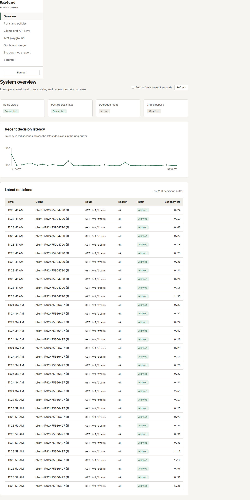
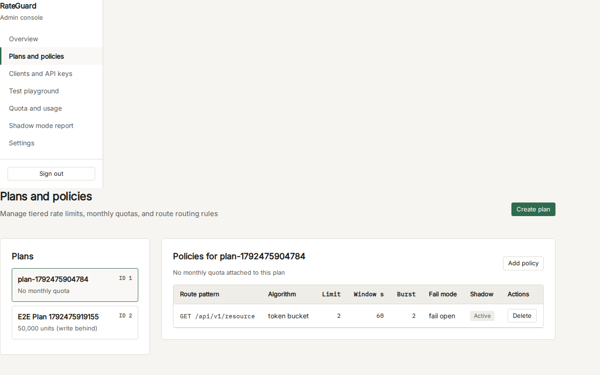
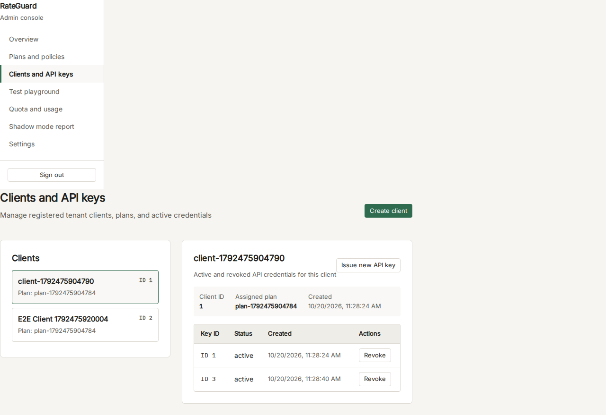
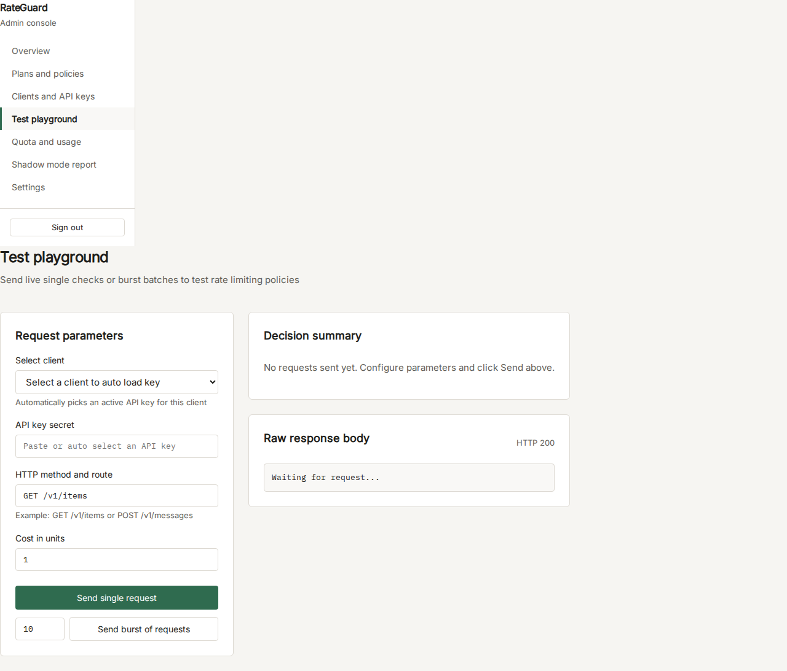
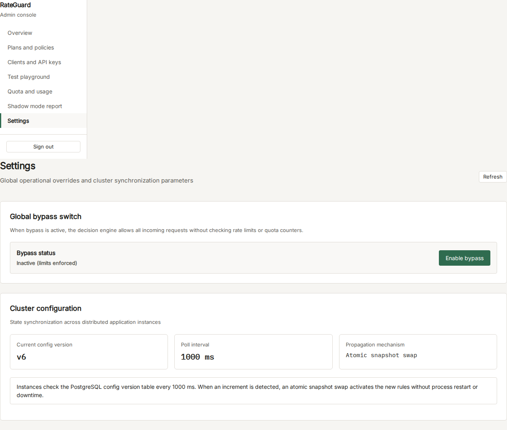

# RateGuard

A high-performance, deterministic rate-limiting and monthly quota decision service built with Node.js, TypeScript, Fastify, Redis, and PostgreSQL.

RateGuard decouples rate-limiting policy evaluation from upstream application services. By evaluating rate state atomically inside Redis using Lua scripts and synchronizing configuration and quotas with PostgreSQL, RateGuard ensures global consistency across distributed service instances without multi-roundtrip network races.

---

## Architecture Overview

```
                      +-----------------------------+
                      |   Client / API Consumer     |
                      +--------------+--------------+
                                     |
                                     v
                      +-----------------------------+
                      | Upstream Service / Demo API |
                      |    (Limiter Middleware)     |
                      +--------------+--------------+
                                     |
                                     | POST /v1/check
                                     v
    +----------------------------------------------------------------+
    |                     RateGuard Decision Cluster                 |
    |                                                                |
    |   +------------------+  +------------------+  +------------+   |
    |   | Instance 1 (App) |  | Instance 2 (App) |  | Instance 3 |   |
    |   +--------+---------+  +--------+---------+  +-----+------+   |
    |            |                     |                  |          |
    |            +----------+----------+------------------+          |
    |                       |                                        |
    |       +---------------+---------------+                        |
    |       |                               |                        |
    |       v                               v                        |
    | +---------------+            +------------------+              |
    | |  Redis Store  |            | PostgreSQL Store |              |
    | | (EVALSHA Lua) |            | (Config, Quotas) |              |
    | +---------------+            +------------------+              |
    +----------------------------------------------------------------+
```

### Order of Checks (10 Stages)

Every incoming check request follows an exact 10-stage pipeline:

1. **Authentication**: Validates request structure and tenant identity credentials.
2. **Input Validation**: Strict schema verification via Zod (`api_key`, `route`, `cost`).
3. **Global Bypass**: Instant return (`allowed: true`, reason: `bypass`) if operational override is active.
4. **Client & Plan Resolution**: Constant-time SHA-256 hash lookup against the in-memory configuration snapshot.
5. **Route Policy Resolution**: Specificity hierarchy: `Exact route` > `Longest prefix` > `Wildcard (*)` > `Plan default`.
6. **Rate Evaluation**: Atomic Redis Lua execution (`EVALSHA` with fallback) using the Redis `TIME` command.
7. **Quota Evaluation**:
   - *Exact mode*: Synchronous conditional row update in PostgreSQL (`used + cost <= quota_limit`).
   - *Write-behind mode*: Monotonic Redis counter check (`INCRBY`) with periodic background PostgreSQL flusher (`GREATEST`).
8. **Response Construction**: Calculates remaining tokens, reset window, and retry timing (`Retry-After`).
9. **Shadow Mode**: If enabled on the policy, overrides `allowed` to `true` while preserving the computed denial reason and telemetry.
10. **Metrics & Decision Buffer**: Increments Prometheus counters/histograms and captures records into the in-memory 200-decision ring buffer.

---

## Rate-Limiting Algorithms & Trade-offs

RateGuard supports four distinct rate algorithms:

| Algorithm | State Structure | Redis Calls | Boundary Burst Resistance | Memory per Client | Primary Use Case |
|---|---|---|---|---|---|
| **Token Bucket** | Hash (`tokens`, `last_updated`) | 1 (`EVALSHA`) | High (damped by capacity) | ~125 B | API endpoints allowing controlled bursts with smooth continuous refill. |
| **Fixed Window** | String counter (`INCRBY` + `EXPIRE`) | 1 (`EVALSHA`) | None (admits up to 2x limit at window boundaries) | ~113 B | Simple background tasks or daily utility quotas. |
| **Sliding Window Counter** | Hash (`prev_count`, `curr_count`) | 1 (`EVALSHA`) | High (weighted time approximation mitigates boundary burst) | ~121 B | General high-throughput API endpoints balancing low memory and high accuracy. |
| **Sliding Window Log** | Sorted Set (`ZADD`, `ZREMRANGEBYSCORE`) | 1 (`EVALSHA`) | Absolute (exact timestamps) | O(N) entries | Ground-truth baseline used in tests to measure approximation error. |

### Quota Enforcement Trade-offs

- **Exact Mode (PostgreSQL)**:
  - *Mechanism*: Conditional `UPDATE clients_quota SET used = used + $cost WHERE used + $cost <= limit`.
  - *Trade-off*: Absolute zero over-admission guarantee under extreme concurrency. Throughput is constrained by database row locking (~370 ops/s).
- **Write-Behind Mode (Redis + Flusher)**:
  - *Mechanism*: Atomic Redis counter with a 5-second background flusher applying monotonic `GREATEST(used, $redis_val)` updates to PostgreSQL.
  - *Trade-off*: 5.9x higher throughput (~2,174 ops/s) and sub-millisecond p50 latency. In the event of a sudden Redis crash, up to 5 seconds of request counts within the flush window may be lost.

---

## Empirical Benchmark Results

Measured on 12th Gen Intel Core i5-12450H (12 cores), 16 GB RAM, Node.js v22.22.1, Linux x64:

### 1. Decision Latency per Algorithm

| Algorithm | p50 Latency | p95 Latency | p99 Latency | Average Latency | Throughput |
|---|---|---|---|---|---|
| **Token Bucket** | 1.53 ms | 2.69 ms | 3.48 ms | 1.65 ms | 606 req/s |
| **Fixed Window** | 1.23 ms | 2.00 ms | 2.65 ms | 1.25 ms | 801 req/s |
| **Sliding Window Counter** | 1.15 ms | 1.99 ms | 3.38 ms | 1.63 ms | 614 req/s |

### 2. Redis Operations per Decision

All algorithms execute in a single network round-trip via preloaded Lua scripts (`EVALSHA`), guaranteeing atomic execution and zero race conditions.

### 3. Memory Consumption (100,000 Keys)

| Algorithm | Bytes per Client Key | Memory for 100,000 Keys |
|---|---|---|
| **Fixed Window** | 113 B | 10.8 MB |
| **Sliding Window Counter** | 121 B | 11.5 MB |
| **Token Bucket** | 125 B | 11.9 MB |

### 4. Sliding Counter Accuracy vs Ground-Truth Log Baseline

Across random distributed traffic patterns, the sliding window counter approximation demonstrated a **0.00% error rate** against the exact sorted-set log baseline.

### 5. Quota Performance Comparison

| Quota Strategy | Storage Layer | p50 Latency | p99 Latency | Throughput | Concurrency Safety |
|---|---|---|---|---|---|
| **Exact** | PostgreSQL Row Lock | 2.61 ms | 4.98 ms | 371 ops/s | Never over-admits |
| **Write-Behind** | Redis Monotonic Counter | 0.31 ms | 1.62 ms | 2,174 ops/s | Monotonic sync with 5s flush window |

### 6. Scaling Across App Instances

| Cluster Configuration | Sustained Throughput | Processing Time (1,500 Requests) |
|---|---|---|
| **1 Instance** | 1,820 req/s | 824 ms |
| **2 Instances** | 2,564 req/s | 585 ms |
| **3 Instances** | 2,963 req/s | 506 ms |

### 7. Graceful Failure & Recovery

- **Redis Failure Detection**: 4.72 ms (transitions to `degraded` mode; policies fail-open or fail-closed accordingly).
- **Redis Reconnect Recovery**: 1.41 ms (automatic restoration of normal rate limits).

---

## Admin Console (Phase 8)

The RateGuard Admin Console is a lightweight, zero-dependency control panel served directly by the backend at `/console`. It contains zero business logic and renders real telemetry and configuration state from the admin API.

### Design Principles
- **Restrained Typography & Theme**: Pure light theme (`#F6F5F2` page background, `#FFFFFF` surfaces, `#2F6B4F` muted green accent). Offline font rendering with bundled `@fontsource/inter` and `@fontsource/ibm-plex-mono`.
- **Zero Dash / Markdown Formatting**: Strictly audited copy without em dashes, en dashes, or markdown emphasis tokens.
- **In-Memory Security**: Admin session token is stored exclusively in memory and never persisted in `localStorage` or browser storage.

### Console Previews

#### System Overview (1280px Desktop)


#### Plans and Policies Configuration (1280px Desktop)


#### Clients and API Keys Management (1280px Desktop)


#### Interactive Test Playground (1280px Desktop)


#### Global Settings & Bypass Switch (1280px Desktop)


---

## Quick Start & Reproduction

### 1. Prerequisites
- Docker & Docker Compose **or** Node.js 20+, Redis 7+, PostgreSQL 15+

### 2. Run with Docker Compose
```bash
# Launch PostgreSQL, Redis, and 3 RateGuard instances behind a round-robin proxy
docker compose up -d

# Check cluster readiness
curl http://localhost:3000/readyz
```

### 3. Local Development Setup
```bash
# Install dependencies
npm install

# Build backend and admin console
npm run build

# Run unit and integration tests (T1 to T18)
npm test

# Run browser E2E test suite
npm run test:e2e

# Run benchmark harness
npm run bench

# Run interactive end-to-end demonstration
npm run demo
```

---

## Test Verification Suite (T1 to T18)

RateGuard implements every test required by Section 19 of the Project Initiation Document:

- **T1**: Unit tests for all four algorithms using simulated time.
- **T2**: Concurrency race demonstration (naive get-and-set over-admits; atomic Lua limiter stays strictly within bounds).
- **T3**: Fixed window boundary burst demonstration vs sliding window counter mitigation.
- **T4**: Empirical accuracy comparison between sliding window counter and ground-truth sliding log.
- **T5**: Token bucket capacity burst and sustained refill rate verification.
- **T6**: Global rate limit enforcement across 3 distributed instances behind a round-robin proxy.
- **T7**: Cost-weighted multi-unit consumption verification.
- **T8**: Route policy specificity resolution hierarchy (`exact` > `longest prefix` > `wildcard` > `default`).
- **T9**: Dynamic hot-reload via atomic snapshot swap without process restart.
- **T10**: Exact quota under concurrency: conditional PostgreSQL atomic updates guarantee zero over-admission.
- **T11**: Write-behind quota under concurrency with simulated storage crash.
- **T12**: Redis failure resilience: fail-open policies allow traffic with `degraded: true`; fail-closed policies reject with `limiter_unavailable`.
- **T13**: PostgreSQL outage survival: cached in-memory snapshot continues uninterrupted rate decision processing.
- **T14**: Shadow mode policy verification (`allowed: true`, `shadow: true`, denial reason logged).
- **T15**: Global bypass switch verification.
- **T16**: Automatic rate token refund when downstream monthly quota check denies admission.
- **T17**: Security hardening (constant-time token comparison, API key secrecy from logs, Zod schema validation).
- **T18**: Repeatability verification (concurrency suite passes 20 consecutive runs with 0 flakiness).

For full requirement mappings, consult [`docs/TRACEABILITY.md`](docs/TRACEABILITY.md) and [`docs/UI_REVIEW.md`](docs/UI_REVIEW.md).
